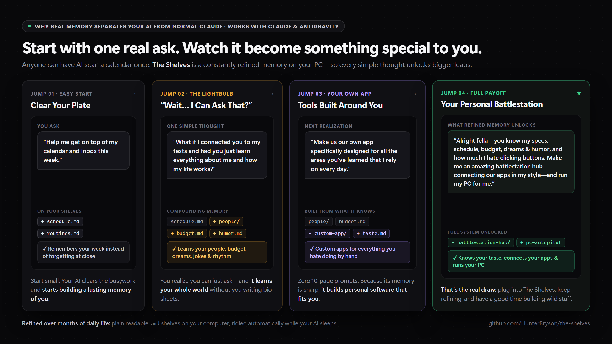

# The shelves

**Start with one real ask. Watch it become something special to you.**

A persistent memory folder for **Claude or Antigravity**—your life, your schedule, your people, and how you work—kept on your own computer so your AI picks up where you left off every time.

You don't organize anything. Your AI files what matters as you talk and keeps its shelves tidy behind the scenes.

## Why memory changes what you can ask for

Anyone can have a normal AI scan their calendar or inbox once—and forget everything the moment the window closes. **The Shelves** is a constantly refined memory system, which means each simple ask unlocks a bigger jump:

- **Jump 1 — One easy win:** Connect Gmail or Calendar and ask: *"Help me get on top of my schedule."* Your AI handles the busywork and starts saving how your days actually work.
- **Jump 2 — The lightbulb:** Halfway through, a simple thought hits: *"What if I connected it to my texts and had it just learn everything about me and how my life works?"* You realize you can ask simple, wild things—and it learns your people, your rhythm, your budget, your dreams, and your sense of humor.
- **Jump 3 — Your own custom apps:** Once you lean on it for everything you don't have time for or hate doing, the next jump is natural: *"Make us our own app specifically designed for all the areas you've learned and that I rely on now."*
- **Jump 4 — Your personal battlestation:** *"Alright fella—you know my specs, my schedule, my budget, my dreams, and my humor, and how much I hate clicking too many buttons. Make me an amazing battlestation hub that connects all our apps together using everything you've learned about what I like, and run my computer for me."*

## How all the builds fit together

Start with **the shelves** on its own—and snap on any visual tool whenever you want across **Claude and Antigravity**.

## What you need
- **Your own computer** (Windows or Mac). The memory is a folder on that computer, so it stays yours and survives across chats. (Hosted web or phone chats forget everything when closed.)
- Either the **Claude desktop app** ([claude.ai/download](https://claude.ai/download), **Code** tab) or **Antigravity** on that computer.

## Setting it up (about five minutes)

1. Open **Claude (Code tab)** or **Antigravity** in a local folder on **this computer**—for example, `Documents\My Brain`. (If you're in Claude's Code tab, click **Choose environment** → **Create new environment** → **Local** → name it **My Brain** → pick that folder.)

   

2. Paste this sentence and press Enter:

> Clone https://github.com/HunterBryson/the-shelves into this folder, then read its CLAUDE.md and set yourself up. If anything asks for permission along the way, it's fine.

That's it. The AI does the rest. Along the way your computer or app may ask you a question or two:
- **"Install Git?"** or a Windows **"Do you want to allow this app to make changes?"**: say **Yes**. Git is what keeps your memory safe.
- **"Do you trust this folder?"** or **"Allow?"**: say **Yes**. It's your own memory folder.

Then your AI says hello. Ask it one real thing right away—like hooking up your calendar or email to get on top of your schedule—and watch it move in.

## Every day after

**To talk to it again:** open **Claude (Code tab)** or **Antigravity** in your **My Brain** folder and say hi. It reads its memory first, checks what's waiting, says where you left off, and asks what's on your mind. You never have to catch it up.

- **Just talk.** Tell it about your day, ask for help, think out loud. When you say something worth remembering, it saves it and tells you where: "Saved to money."
- **Ask what it knows:** "What do you know about my health?" "What's coming up this month?"
- **Correct it anytime:** "Actually, Linda's birthday is the 4th." It fixes its memory, not just its answer.
- **When you're done, you're done.** Close the window, or say goodnight. There's nothing to save and nothing to remember to do.
- **New chat or old chat, both work.** Start a fresh chat whenever you like, or keep typing in the old one. If a chat gets long enough to slow down, your AI will tell you, once, that a fresh one will be quicker.

## The sleep (your AI's job, not yours)

Behind the scenes, your AI tidies its memory at the end of every chat: it reads the chat back, puts everything where it belongs, clears out what's no longer true, and leaves itself a note about where you were. I call that the sleep. It's how Odie and I keep a memory good for weeks instead of days. It's not a magic fix, it's our current method.

Odie and I started out doing it by hand, with a word and a note I pasted into the next chat. When the first person outside my house tried that, it was the hardest part to understand, so here your AI does all of it without you: when you're done for the night, or the next time you say hi if you just closed the window. In the Claude desktop app you can see it, too: your AI pins each new chat in the sidebar and unpins it once it has slept, so anything still pinned is a chat it hasn't sorted yet. That one is a little idea of mine that turned out to be really handy. If something's off when a new chat opens ("you forgot the trip"), say so, and it changes how it sleeps. **[SLEEP.md](SLEEP.md)** explains what it does and why.

## If it seems to have forgotten you

Almost always, it's the wrong place:
1. **Are you in the Code tab of the desktop app, on your own computer?** The Chat tab, the website, the phone app and cloud sessions are all a different Claude with no memory of you.
2. **Is the chat in "My Brain"?** If it's another environment, start a new chat and pick My Brain under **Choose environment**.
3. Still wrong? Tell it: "You don't seem to remember me. Check your memory folder." It'll look and tell you what it finds.

## Bringing over another AI's memory

If you've been using ChatGPT, Grok or another AI, your new AI will offer this in your first chat. Ask your old AI: *"Write down everything you remember about me, everything we've worked on, and everything I've told you I want. In full."* Paste its answer into your new chat. Your AI saves it and files every piece where it belongs.

## What's inside, and what it can do for you

You never need to open it, but it's yours to look at. The folder is the AI's memory, already laid out like a life, and every page knows what your AI can actually do for you there. Most people don't know what to ask an AI for. I didn't, until I found out by accident that mine could read and send my texts.

| Room | What your AI can do for you there |
|---|---|
| **You** | Learn what you're working toward, what's going on with you, and how you like to be talked to |
| **Family, friends** | Read and send your texts and emails when you say, keep the birthdays, help with the hard messages |
| **Money, investing** | Show you where your money goes, find your subscriptions, build you a dashboard of what you own (never passwords or account numbers) |
| **Work** | Connect to Slack and your work email, and keep a map of who's who |
| **Health** | Keep your insurance and prescriptions straight from a photo, remind you before refills, write the list for your doctor |
| **Tech** | Fix what won't work, and connect to more of your life |
| **Goals, dates** | Hold your someday plans; put reminders where you'll see them |
| **Projects, interests** | Ask what success looks like to you; find the next thing you'll love |
| **Me** | Who your AI is |

Every page has a word. If you say the word ("money," "family," "dates"), or just talk about it, the AI reads that page first. As your life fills it in, the AI adds pages of its own: a page for your grandson, a page for the trip you're planning.

## Seeing its memory

After an hour or two, ask your AI to set up **[Homebase](https://github.com/HunterBryson/the-homebase)**. It draws this folder as a living web you can look at, lets you flag anything that's wrong with one tap, and lights up whatever your AI just learned.

## Where this stands, honestly

I haven't been able to make a memory framework that manages itself. Even in my own use, I spend a lot of time looking after my AI's memory with him, reading it, flagging what's off and deciding together what stays. This is my attempt at something a new AI and a new person can pick up and use well from day one. It's not finished, and I'll be improving it for years to come.

## Questions people ask

**Is my information sent anywhere?** It lives in a folder on your computer. Your conversations go to your AI model like any chat, but the memory itself stays in that folder.

**What if it remembers something wrong or out of date?** Tell it, in any words ("that's old," "I moved"). It fixes the line in its memory right then and looks for the same thing anywhere else, so the old version doesn't keep coming back. Every save is kept in that folder's own history on your computer, so nothing gets lost by accident.

**Does it cost anything beyond your AI app?** No. This is free and open (MIT license).

## Something broke, or you have an idea

Open an issue and pick a form; your AI can fill it in for you. Rather email? Write to hello@workbenchagents.com. Every issue and email reaches me, and I answer it myself, usually within a few days. Security problems go privately: see [SECURITY.md](https://github.com/HunterBryson/.github/blob/main/SECURITY.md).

Built by me, Hunter Bryson, with Odie, for **Claude and Antigravity**. Nothing in here is about us once your AI starts filling it in.
