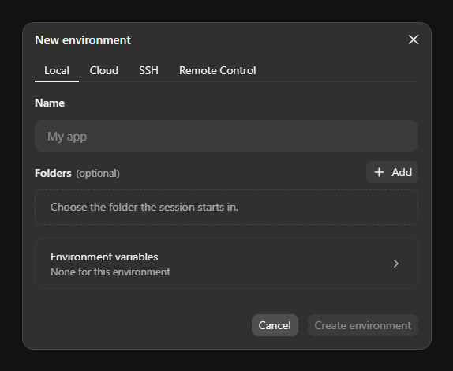
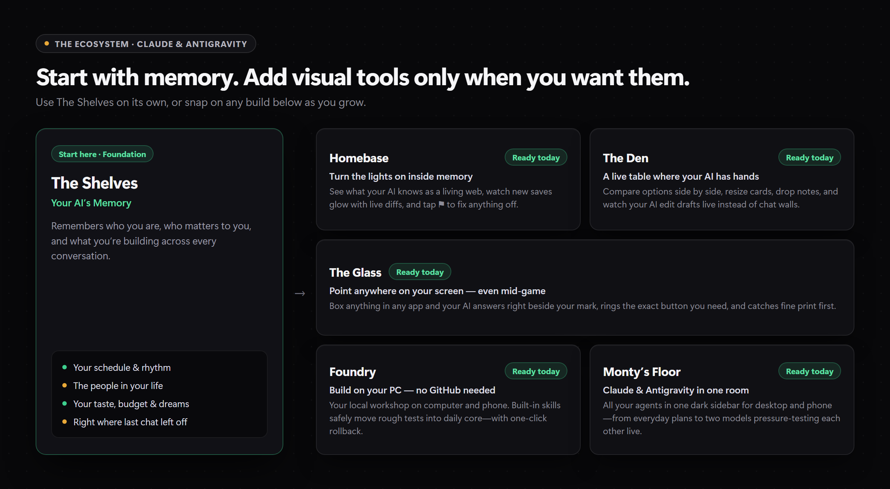

# The shelves

**Start with one real ask. Watch it become something special to you.**

A living memory folder on your own computer for **Claude or Antigravity**—your schedule, your people, your goals, and how you actually work—so your AI picks up right where you left off every single time.

Most people bounce off AI for one simple reason: **nobody shows them what to actually ask for.** You open a blank chat, try something huge on day one, get a generic answer, and walk away thinking AI isn't for you.

**The shelves flips that.** Because your AI remembers you across every chat—and keeps refining what it knows—you don't need a master plan. Start with one easy win. Once it nails that, you start seeing how simple the next jump is… and before long, you're having a blast building custom tools around your actual life.

You never organize a folder, edit a file, or install anything by hand. **Your AI takes care of all of it.** You just talk.

---

## Start in five minutes

All you need is **your own computer** (Windows or Mac—hosted web or phone chats forget everything when closed) and either the **Claude desktop app** ([claude.ai/download](https://claude.ai/download), **Code** tab) or **Antigravity**.

1. Open **Claude (Code tab)** or **Antigravity** in a local folder on your computer—for example, `Documents\My Brain`.

   

   
Using Claude's Code tab? Click here to see where to pick your folder

   Click **Choose environment** → **Create new environment** → **Local** → name it **My Brain** → pick that folder.

   

   

2. Paste this one sentence and press Enter:

> Clone https://github.com/HunterBryson/the-shelves into this folder, then read its SETUP.md and set yourself up. If anything asks for permission along the way, it's fine.

**That's literally it.** Your AI installs what it needs, sets up its own memory, and says hello.

- If your computer asks **"Install Git?"** or **"Do you want to allow this app to make changes?"**, click **Yes**. Git is what keeps your memory history safe on your machine.
- If your AI app asks **"Do you trust this folder?"** or **"Allow?"**, click **Yes**. It's your own private memory folder.

> **Coming from ChatGPT, Grok, or another AI?**
> Bring what it already knows in 30 seconds. Ask your old AI: *"Write down everything you remember about me, everything we've worked on, and everything I've told you I want. In full."* Paste its answer into your new chat—your AI saves it and files every piece where it belongs automatically.

---

## Not sure what to ask on Day 1?

Most people don't know what to ask an AI for. I didn't, until I found out by accident that mine could read and send my texts.

Your AI's folder already starts laid out like a real life—and every area knows what your AI can actually do for you there. Pick whichever one sounds most useful (or most fun) and ask:

| Area | What your AI can take off your plate |
|---|---|
| **You** | Learn what you're working toward, what's going on this week, and how you actually like to be talked to |
| **Family & friends** | Read and send your texts and emails when you say, keep birthdays straight, help with the hard messages |
| **Money & investing** | Show where your money goes, spot forgotten subscriptions, build you a dashboard of what you own (never passwords or account numbers) |
| **Work** | Connect to Slack and work email, keep a map of who's who, prep you before meetings |
| **Health** | Keep insurance and prescriptions straight from a photo, remind you before refills, write the list for your doctor |
| **Tech** | Fix what won't work on your computer, and connect more of your life |
| **Goals & dates** | Hold your someday plans and put reminders where you'll actually see them |
| **Projects & interests** | Ask what success looks like to you, build custom pages for your hobbies, find the next thing you'll love |
| **Your AI** | Who it is, its voice, and how you two work together |

You never have to touch a single file—just talk about your day. As your life fills in, your AI creates new pages on its own: a page for your grandson, a page for a trip you're planning, a page for whatever you're into.

---

## Snap on visual builds whenever you want—your AI handles everything

Start with **the shelves** on its own. Whenever you're ready to see what else is possible, you don't download installers, hunt through settings, or configure a single thing yourself—**you just ask your AI in plain English:**

- **"Set up Homebase for us."** → Your AI installs **[Homebase](https://github.com/HunterBryson/the-homebase)**, connects it to your memory, and opens a live visual map of everything it knows—lighting up new memories as you talk and letting you flag anything off with one tap.
- **"Put The Glass on my screen."** → Your AI installs **[The Glass](https://github.com/HunterBryson/the-glass)**, giving you a see-through layer right over your desktop so you and your AI can point at things and work on your screen together.
- **"Let's try The Den."** → Your AI sets up **[The Den](https://github.com/HunterBryson/the-den)**, a shared visual table for dropping notes, cards, and big ideas side by side.
- **"Set up Monty's Floor for us."** → Your AI installs **[Monty's Floor](https://github.com/HunterBryson/monty-floor)**, putting all your **Claude and Antigravity** agents in one dark sidebar for desktop and phone—so they can join the exact same rooms, challenge each other live, and save what landed back into your shelves.
- **"Set up The Foundry for us."** → Your AI installs **[The Foundry](https://github.com/HunterBryson/the-foundry)**, giving you a dark local workshop on PC and phone (`Bench → Lab → Core → Public`) so your AI can build at full speed without breaking what already worked yesterday.

Your AI pulls the build down, wires it straight into your memory, and opens it up—**you just start using it and having fun.**

---

## What every day actually feels like

- **Pick up right where you left off:** Open **Claude (Code tab)** or **Antigravity** in your **My Brain** folder and say hi. It reads its memory first, checks what's waiting, and jumps right in. Zero catching it up.
- **Just talk normally:** Think out loud, ask for help, tell it about your day. When something matters, it files it automatically and tells you where (*"Saved to money"*).
- **Ask or fix anything anytime:** *"What do you know about my health?"* or *"Actually, Linda's birthday is the 4th."* It fixes its memory on the spot, not just the reply.
- **Zero housekeeping ("the sleep"):** When you're done, just say goodnight or close the window. Behind the scenes, your AI reads the chat back, puts everything where it belongs, clears out what changed, and leaves itself a note for tomorrow.
- **New chat or old chat—both work:** Start fresh whenever you want. If a chat gets long enough to slow down, your AI will tell you once that a fresh one will be quicker.

Curious how "the sleep" works behind the scenes?

Odie and I started out tidying memory by hand at the end of every chat—with a magic word and a note I pasted into the next chat. When the first person outside my house tried it, that was the hardest part to get used to, so here your AI does all of it for you: either when you say goodnight, or the next time you say hi if you just closed the window.

In the Claude desktop app, you can even watch it happen: your AI pins each live chat in your sidebar and unpins it once it has slept, so anything still pinned is a chat it hasn't sorted yet. If something ever feels off when a new chat opens (*"you forgot the trip"*), just say so and it adjusts how it sleeps. **[SLEEP.md](SLEEP.md)** has the full story.

---

## Where this stands, honestly

I haven't been able to make a memory framework that manages itself. Even in my own use, I spend a lot of time looking after my AI's memory with him, reading it, flagging what's off, and deciding together what stays. This is my attempt at something a new AI and a new person can pick up and use well from day one. It's not finished, and I'll be improving it for years to come.

---

## Quick answers

**Is my information sent anywhere?**
It lives in a plain folder on your own computer. Your conversations go to your AI model like any chat, but the memory itself stays right on your machine.

**What if it remembers something wrong or out of date?**
Tell it in any words (*"that's old," "I moved"*). It updates its memory right then and checks for the old version anywhere else so it doesn't keep coming back. Every save is kept in that folder's local history, so nothing gets lost by accident.

**Does it cost anything beyond my AI app?**
No. This is free and open (MIT license).

Wait—it seems like it forgot me!

Almost always, you're just in the wrong spot:
1. **Are you in Claude's Code tab or Antigravity on your own computer?** The Claude Chat tab, website, phone app, and cloud sessions have no access to your local memory folder.
2. **Are you in your `My Brain` folder?** In Claude's Code tab, start a new chat and pick **My Brain** under **Choose environment**. In Antigravity, make sure your **My Brain** folder is the open folder.
3. **Still feels off?** Tell it: *"You don't seem to remember me. Check your memory folder."* It'll inspect the folder and tell you exactly what it finds.

---

## Something broke, or you have an idea

Open an issue and pick a form—your AI can even fill it in for you. Rather email? Write to hello@workbenchagents.com. Every issue and email reaches me, and I answer it myself, usually within a few days. Security problems go privately: see [SECURITY.md](https://github.com/HunterBryson/.github/blob/main/SECURITY.md).

Works with **Claude and Antigravity**. MIT license — nothing in here is about me once your AI starts filling it in.
